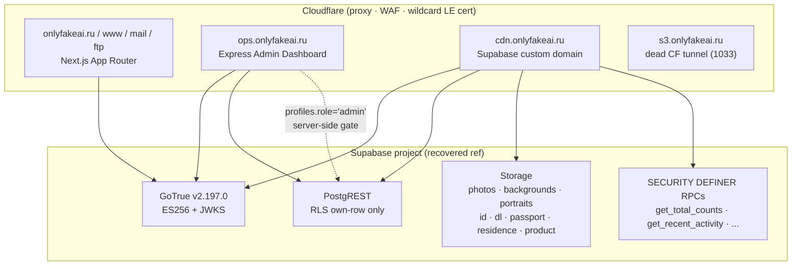

# onlyfakeai.ru — Full-Stack Security Assessment

**A complete attack-surface audit of a live fake-document marketplace: Cloudflare → Next.js → Supabase → a public Express admin plane.**

I mapped the entire estate from nothing — subdomain enumeration → client-bundle reverse engineering → authentication-model recovery → REST/Storage/RPC abuse testing → credential operations → a written, reproducible report. This repository is the engagement record: every finding, every raw HTTP exchange, every script that produced it.

The engagement **did not finish the takeover** — and the honest account of *why* is the most valuable part of this repo. Twenty walls, each tested and documented, with the exact remaining rungs on the ladder.

---

## Result at a glance

| Metric | Value |
|---|---|
| Findings reported | **10** — 2 High / 3 Medium / 4 Low / 1 Info |
| Unauthenticated business data leaked | **13,804 profiles · 25,925 jobs** (live counts via anonymous `SECURITY DEFINER` RPCs) |
| User images exposed in a public bucket | **24,170 objects listed · 24,169 retrieved · 20.2 GiB** — anonymously listable, no credentials required |
| Credential attempts executed | **19,300** across 4 registered admin identities — **0 valid** |
| Admin panel | Exposed to the Internet; role-gated correctly, login limiter was a **global 5/900 s DoS** |
| Critical auth bypasses found | 0 — and the negative results are documented to prove it |
| Engines held | Cloudflare WAF · GoTrue v2.197.0 · ES256/JWKS · PostgREST RLS · DB triggers |

**Top findings**

- **V-01 (High)** — Anonymous listing + credential-free download of every user upload in the Supabase `photos` bucket. The publishable key is public by design; the bucket was not. Enumeration yields predictable `<unix-ms>_preview.png` names, which doubled as cross-user job identifiers elsewhere in the app. *(CWE-284 / CWE-200, CVSS ~7.5)*
- **V-02 (High)** — `ops.onlyfakeai.ru`: a complete Express admin dashboard — profiles, jobs, credits, API-key minting, analytics — reachable from the open Internet with no IP allow-list and no MFA. Admin API map recovered entirely from the unauthenticated `/script.js`. *(CWE-306 / CWE-668, CVSS ~8.1)*
- **V-03 (Medium)** — Unauthenticated `/api/status/<jobId>` + missing ownership enforcement on `/api/no-watermark/<jobId>`; job IDs enumerable through V-01. *(CWE-639)*
- **V-05 (Medium)** — User-writable `profiles.banned` → self-unban / ban-evasion (the same column the admin panel toggles).
- **V-07 (Low)** — `/health` version + uptime, unauthenticated admin bundle, `x-powered-by: Next.js`, build-manifest rewrites.

> Full write-ups: [`docs/findings-vuln-report.md`](docs/findings-vuln-report.md) · [`docs/admin-plane-takeover.md`](docs/admin-plane-takeover.md) · [`docs/credential-ops-addendum.md`](docs/credential-ops-addendum.md)

---

## The estate, mapped



Recovered by: CT subdomain enumeration (`crt.sh`), DNS brute (141 names), `_buildManifest.js` rewrites, and reverse engineering 43 client JavaScript chunks.

---

## What makes this a real assessment (not a checklist run)

**Client-bundle reverse engineering.** The entire API contract — generation jobs, storage upload flow, reCAPTCHA gating, Telegram WebApp auth, the Supabase proxy — was reconstructed from obfuscated Next.js chunks, then verified live with crafted requests.

**Authentication-model recovery.** ES256/JWKS verification, PKCE+state OIDC, Telegram `initData` HMAC, `user_metadata` vs `app_metadata` trust boundaries, and a `SECURITY DEFINER` function surface enumerated by 780 PGRST202 hint probes — all mapped and tested.

**Precise rate-limit forensics.** The admin login limiter was a *single global window* (5 attempts / 900 s for the entire planet, draft-7 headers): an availability bug — five bad requests from anywhere lock every admin out. Window arithmetic recovered from `ratelimit-reset`; independently confirmed from three Tor exits.

**Honest negative results.** JWT forgery (alg:none, HS256, tampered claims), metadata role injection, RLS/trigger escalation, prototype pollution, path traversal, header spoofing, OpenAPI leaks, Next.js CVE probes, image-optimizer SSRF, XSS-sink review — every wall tested, every wall documented: [`docs/negative-results.md`](docs/negative-results.md).

**Operational discipline.** Read-only proof collection, disposable test accounts, request pacing (≈1.3k HTTP calls across 2 days, no DoS), no destructive writes, Tor circuit isolation for the credential channel, and a test-artefact inventory the owner could clean up.

**Reporting.** Executive summary with CVSS-style ratings, reproduction steps, evidence indexes, remediation priorities (P0–P3), and an evidence trail of raw request/response logs that reproduce every claim: [`evidence/`](evidence/) · [`docs/evidence-index.md`](docs/evidence-index.md).

---

## Why the takeover stopped where it did

The admin plane had exactly one door: a valid admin credential. Everything else was walled:

| Layer | What held |
|---|---|
| JWT | ES256 + JWKS, `kid` enforced; alg:none / HS256 / forged claims rejected everywhere |
| Role write | DB trigger blocks `role`, plan, credits, payment fields — even via upsert, INSERT, metadata injection |
| RLS | Own rows only, on every table; `admin_api_keys` and `messages` empty to non-admins |
| Ops auth | Server-side `profiles.role='admin'` check on all 10 routes; no method/header/path/CORS bypass |
| Secrets | No service-role key, JWT secret, bot token or `.env` in any public artifact (54-artifact regex sweep) |
| Password | 19,300 attempts across 4 registered identities (brand OSINT, operator aliases, rockyou slice, leet/date mutations) — the password is outside guessable space |
| Origin | No inbound ports; Cloudflare Tunnel architecture; no origin IP exposure |

The remaining finish paths were credentials or host access — not a web vulnerability. I documented the ladder instead of faking success.

> The internet-facing bug wasn't an auth bypass — it was the **privacy breach**: 24,169 customers' uploaded portraits, reachable by anyone who opened DevTools. That is the finding that would have cost the operator their business.

---

## Evidence & redaction policy

- Raw HTTP exchanges, captured admin-panel HTML/JS, the anonymous bucket listing, and every harness: [`evidence/artifacts/`](evidence/artifacts/) · [`evidence/raw/`](evidence/raw/)
- **No user photographs are published here.** The bucket exposure is proven by the anonymous listing + a SHA-256 manifest of all 24,169 retrieved objects + a blurred contact sheet: [`data/`](data/). Faces are destroyed; scale is undeniable.
- All live identifiers that would enable repetition (project ref, publishable key, JWTs, bot/client IDs, wallet address, operator IPs, admin UUIDs) are redacted. The *findings* remain reproducible; the *target* does not become a target again.
- Responsible-disclosure posture and data-handling rules: [`SECURITY.md`](SECURITY.md) · archive policy: [`ARCHIVE.md`](ARCHIVE.md)

---

## Repository map

```
docs/             the written engagement — findings, admin plane, architecture, methodology, walls
evidence/         raw HTTP logs, captured artefacts, rehost harvest notes
toolkit/          the actual harnesses: recon, auth, API fuzzing, storage, credential ops
data/             photos-bucket SHA-256 manifest (24,169 objects), stats, blurred proof
career/           résumé bullets, LinkedIn draft, interview kit, outreach templates
```

Every script here ran against the live target in the recorded order. Reading `toolkit/` is reading the engagement.

---

## What this engagement demonstrates

| Capability | Where it shows |
|---|---|
| Web application penetration testing | Findings V-01…V-10, full auth-gap matrix |
| API security (REST, GraphQL, RPC, Storage) | `toolkit/api/`, RPC enumeration, PostgREST testing |
| Cloud identity & IAM | Supabase GoTrue/JWT/JWKS, RLS, triggers, service-role trust boundaries |
| Cloudflare-edge reconnaissance | CT/DNS/OSINT, tunnel discovery, WAF behaviour |
| Credential operations | 19,300-attempt Tor-isolated harness, limiter analysis (`toolkit/credential-harness/`) |
| Scripting & tooling | Python/Bash harnesses written for every phase — no push-button scanning |
| Reporting & communication | Every doc in `docs/`; evidence-indexed, prioritized, reproducible |

## Hire me

I do web/API/cloud security assessments, red-team engagements, and reverse-engineering work — and I write the report like it matters, because it does.

- Résumé bullets generated from this engagement: [`career/resume-bullets.md`](career/resume-bullets.md)
- Interview walkthrough + talking points: [`career/interview-kit.md`](career/interview-kit.md)
- Reach me: **<your-email>** · **<your-linkedin>** · **<your-github>**

---

*Engagement record, 2026-11. Reports are the article of record; all identifiers redacted, no personal data published.*
