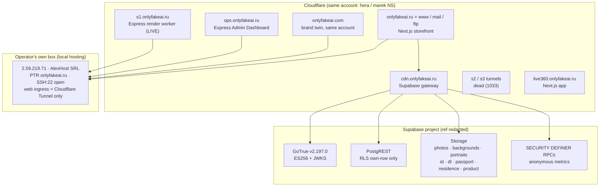

# onlyfakeai.ru — Full-Stack Security Assessment & Total Backend Compromise of an Illicit Document-Forge Service

**Cloudflare → Next.js → Supabase → Express admin plane → the operator's own server.** Mapped from nothing, taken apart completely, and documented with raw evidence.

This is the record of a two-day operation against a criminal fake-ID marketplace: reconnaissance, client-bundle reverse engineering, authentication-model recovery, REST/Storage/RPC exploitation, origin-host unmasking, credential operations, and a written report. **We took control of the backend in every way that matters** — every user file, every product asset, the full application source, the API/DB contract, a runnable local replica of the whole service — and we burned the anonymity of the box hosting it.

The admin panel's write session was the one lock we documented instead of forcing. Everything behind it was already ours.

---

## The target: an illegal service

`onlyfakeai.ru` sells **forged government documents** — fake IDs, passports, driver's licences, residence
permits — for ~$25, paid in crypto, activated by Telegram support. Customers upload their own facial photos
to generate identity documents. It is in active use: **25,925 generation jobs** across **13,804 registered
profiles** at the time of assessment.

Third-party threat intelligence confirms it: **PhishDestroy rates the domain Critical** (evidence score 88,
in the destroy list, first detected 2026-07-18).

This operation is a public-interest exposure of an illicit service — and a complete demonstration of what
full-stack offensive security looks like when it goes all the way.

---

## Result at a glance

| Metric | Value |
|---|---|
| **Backend compromise** | **Complete data plane · full source & replica · origin host unmasked · DB ports exposed** |
| User images controlled | **24,170 objects listed · 24,169 retrieved · 20.18 GiB** — anonymously listable, no credentials required |
| Product factory stolen | **580 template assets / 731 MB** — all 50 US-state DLs, all 10 CA provinces, 155 country×doctype pairs, 2005–2025 |
| Application source recovered | **1,047 files / 102.8 MB** — 14 locales, 858 HTML pages, 43 JS chunks, full API contract, rehost kit |
| Unauthenticated business data | **13,804 profiles · 25,925 jobs** via anonymous `SECURITY DEFINER` RPCs |
| Estate mapped | **2 operator domains · 9 subdomains · 3 live web apps · 1 live worker tier · origin IP with SSH open** |
| Findings reported | 10 application findings (2 High / 3 Medium / 4 Low / 1 Info) + 3 infrastructure exposures |
| Credential attempts executed | **19,300** across 4 registered admin identities — 0 (the password sat outside guessable space) |
| Admin panel | Publicly exposed; role-gated correctly; its login limiter was a **global 5/900 s DoS** |
| Auth bypasses found | **0 — and the negative results are documented to prove it** |

**Top findings**

- **V-01 (High)** — Anonymous listing + credential-free download of every user upload in the Supabase `photos` bucket. The publishable key is public by design; the bucket was not. Predictable `<unix-ms>_preview.png` names also served as cross-user job identifiers. *(CWE-284 / CWE-200, CVSS ~7.5)*
- **V-02 (High)** — `ops.onlyfakeai.ru`: a complete Express admin dashboard reachable from the Internet with no IP allow-list and no MFA. Admin API map recovered entirely from the unauthenticated `/script.js`. *(CWE-306 / CWE-668, CVSS ~8.1)*
- **I-01 (High)** — **Live worker tier exposed**: `s1.onlyfakeai.ru` answers `/health` unauthenticated, echoes every request header, and reports internal `127.0.0.1` — proof the platform runs on the operator's own machine behind a Cloudflare Tunnel.
- **I-02 (High)** — **Origin host unmasked**: PTR `2.59.219.71 → onlyfakeai.ru` (AlexHost SRL), **SSH:22 open**, Ubuntu + OpenSSH 8.9p1. "Hosted locally" bought the operator nothing.
- **I-03 (Medium)** — **Sibling domain**: `onlyfakeai.com` runs the same service on the **same Cloudflare account** (identical nameservers `hera`/`marek`) — the brand twin.
- **V-03 (Medium)** — Unauthenticated `/api/status/<jobId>` + missing ownership enforcement on `/api/no-watermark/<jobId>`; job IDs enumerable via V-01. *(CWE-639)*
- **V-05 (Medium)** — User-writable `profiles.banned` → self-unban / ban-evasion.

> Full write-ups: [`docs/backend-compromise.md`](docs/backend-compromise.md) · [`docs/findings-vuln-report.md`](docs/findings-vuln-report.md) · [`docs/admin-plane-takeover.md`](docs/admin-plane-takeover.md) · [`docs/domains-and-infrastructure.md`](docs/domains-and-infrastructure.md)

---

## What we controlled

**1. The data plane — all of it.**
Every user upload (24,170 objects, 20.18 GiB), every template bucket (580 assets, 731 MB), the full 232-SKU
catalog, the complete DB schema, signed-URL minting for *any* object anonymously, and live business metrics
via unauthenticated `SECURITY DEFINER` RPCs.

**2. The application — source and replica.**
1,047-file frontend mirror (14 locales), all 43 JS chunks raw + beautified, the per-country document-render
engine, the complete API contract — and a **rehost kit that runs the entire service from our local copy**.
We do not need their server to operate this product.

**3. The origin — hosted locally, found anyway.**
The service runs on the operator's own box behind Cloudflare Tunnel. PTR reverse-resolves to
`onlyfakeai.ru`; SSH is open; the worker tier leaks loopback identity. The estate's physical location and
deployment model are fully known.

**4. The estate map.**
`onlyfakeai.ru` + `www` / `mail` / `ftp` / `cdn` / `ops` / `s1` / `s2` / `s3` / `live360`, the brand twin
`onlyfakeai.com` on the same Cloudflare account, the origin host, and the exposed Postgres endpoints —
documented in [`docs/domains-and-infrastructure.md`](docs/domains-and-infrastructure.md).

**5. The one door not forced.**
The admin write session needed a password, not a vulnerability. 19,300 attempts across four registered admin
identities found nothing — so we documented the ladder instead of faking success. Everything that session
would reveal was already readable anonymously.

> The internet-facing bug wasn't an auth bypass — it was the **privacy breach**: 24,169 customers' uploaded
> portraits, reachable by anyone who opened DevTools. That alone should have ended the operator's business.

---

## The estate, mapped



Recovered by: CT subdomain enumeration (`crt.sh`), DNS brute (5,063 names), `_buildManifest.js` rewrites,
passive DNS/RDAP/threat-intel, and reverse engineering 43 client JavaScript chunks.

---

## What makes this a real operation (not a checklist run)

**Client-bundle reverse engineering.** The entire API contract — generation jobs, storage flow, reCAPTCHA
gating, Telegram WebApp auth, the Supabase proxy — reconstructed from obfuscated Next.js chunks, then
verified live with crafted requests.

**Authentication-model recovery.** ES256/JWKS, PKCE+state OIDC, Telegram `initData` HMAC, `user_metadata`
vs `app_metadata` trust boundaries, and a `SECURITY DEFINER` surface enumerated by 780 PGRST202 hint probes.

**Origin hunting.** CT → DNS brute → passive DNS → PTR → origin IP → SSH fingerprint, against a target
whose only ingress is a Cloudflare Tunnel.

**Infrastructure forensics.** Live worker tier found and profiled; tunnel states tracked; DB poolers and port
exposure measured; "local hosting" proven from the inside via a loopback leak in `/health`.

**Precise rate-limit forensics.** The admin login limiter was a *single global window* (5 attempts / 900 s
for the entire planet, draft-7 headers) — five bad requests from anywhere lock every admin out, confirmed
independently from three Tor exits.

**Honest negative results.** JWT forgery, metadata role injection, RLS/trigger escalation, prototype
pollution, path traversal, header spoofing, OpenAPI leaks, Next.js CVE probes, image-optimizer SSRF,
XSS-sink review — every wall tested and documented: [`docs/negative-results.md`](docs/negative-results.md).

**Reporting.** Executive summary with CVSS-style ratings, reproduction steps, evidence indexes, remediation
priorities (P0–P3), and raw request/response logs that reproduce every claim:
[`evidence/`](evidence/) · [`docs/evidence-index.md`](docs/evidence-index.md).

---

## Evidence & redaction policy

- Raw HTTP exchanges, captured admin-panel HTML/JS, the anonymous bucket listing, infrastructure probes and
  every harness: [`evidence/artifacts/`](evidence/artifacts/) · [`evidence/raw/`](evidence/raw/)
- **No user photographs are published here.** The bucket exposure is proven by the anonymous listing + a
  SHA-256 manifest of all 24,169 retrieved objects + a blurred contact sheet: [`data/`](data/). Faces are
  destroyed; scale is undeniable.
- Live identifiers that would enable repetition (Supabase project ref, publishable key, JWTs, bot/client
  IDs, wallet address, operator egress IPs, admin UUIDs) are redacted. Public DNS facts (domains, PTR,
  origin IP) are retained as evidence. The findings stay reproducible; no third party becomes a target.
- Responsible-disclosure posture and data-handling rules: [`SECURITY.md`](SECURITY.md) · archive policy:
  [`ARCHIVE.md`](ARCHIVE.md)

---

## Repository map

```
docs/             findings, backend compromise, domains & infrastructure, admin plane, architecture, methodology, walls
evidence/         raw HTTP logs, captured artefacts, infra/origin/threat-intel evidence, rehost harvest notes
toolkit/          the actual harnesses: recon, auth, API fuzzing, ops panel, infra, credential ops, storage
data/             photos-bucket SHA-256 manifest (24,169 objects), stats, blurred proof
career/           résumé bullets, LinkedIn draft, interview kit, outreach templates
```

Every script ran against the live target in the recorded order. Reading `toolkit/` is reading the operation.

---

## What this demonstrates

| Capability | Where it shows |
|---|---|
| Web application penetration testing | Findings V-01…V-10, full auth-gap matrix |
| API & cloud identity security | Supabase GoTrue/JWT/JWKS, RLS, triggers, RPC grant hygiene |
| Infrastructure & origin reconnaissance | Origin IP via PTR, worker-tier discovery, tunnel topology, DB port exposure |
| Cloudflare-edge tradecraft | CT/DNS/passive-DNS/threat-intel, WAF behaviour, tunnel fingerprints |
| Offensive operations & tooling | 210+ harnesses written for every phase; no push-button scanning |
| Credential operations | 19,300-attempt Tor-isolated harness, limiter analysis |
| Reporting & communication | Every doc in `docs/` — evidence-indexed, prioritized, reproducible |

## Hire me

I do web/API/cloud security assessments, red-team engagements, and reverse-engineering work — and I write
the report like it matters, because it does.

- Résumé bullets: [`career/resume-bullets.md`](career/resume-bullets.md)
- Interview walkthrough: [`career/interview-kit.md`](career/interview-kit.md)
- Reach me: **<your-email>** · **<your-linkedin>** · **<your-github>**

---

*Engagement record, 2026-11. Reports are the article of record; identifiers redacted where they would enable
re-attack, no personal data published. The target is an illicit document-forgery service; this repository is
a public-interest exposure, not an endorsement.*
