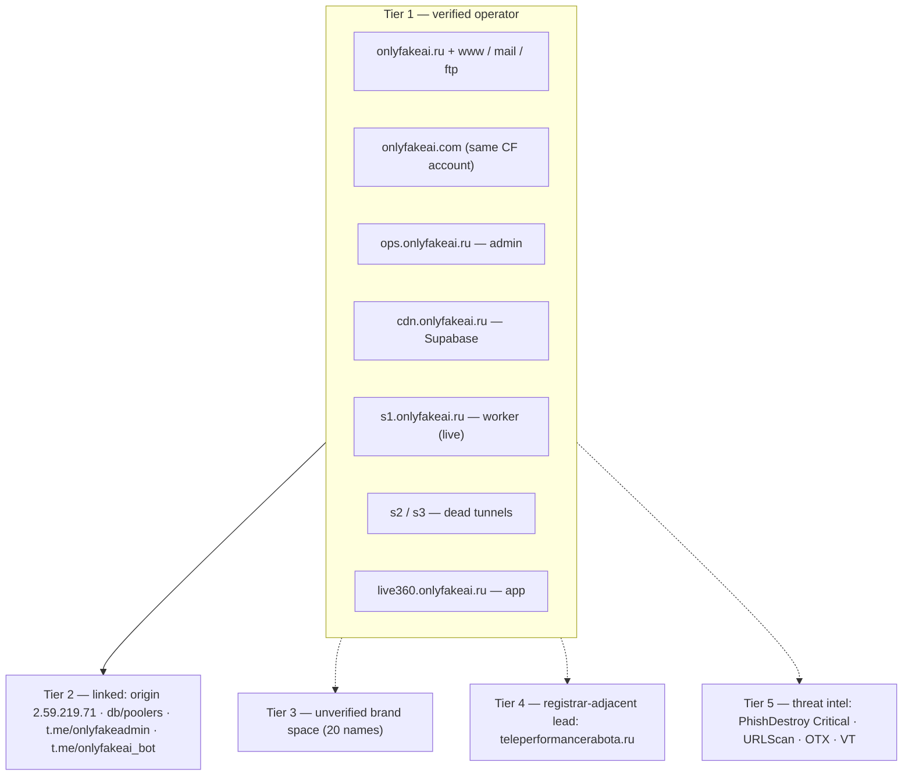

# Domain & infrastructure inventory — the complete estate

Every domain, subdomain, endpoint, contact and certificate associated with the target, with an explicit
**evidence tier** on each entry. Nothing here is implied beyond what the DNS, certificate, HTTP or
threat-intel record actually shows.

> **Attribution policy.** "Verified operator" = same DNS account / certificate / live service / reverse DNS.
> "Unverified brand space" = names in the same brand family that we could **not** tie to the operator;
> several are unrelated businesses. "Registrar-adjacent" = shared registrar or shared provider only — a lead,
> **not** an accusation. This repository does not label any third party a criminal without evidence; the
> target itself (onlyfakeai.ru) is criminal by its product and by third-party threat rating.

---

## Tier 1 — Verified operator: `onlyfakeai.ru`

| Domain / host | Role | Status | Evidence tier |
|---|---|---|---|
| `onlyfakeai.ru` | Apex — Next.js document-forgery storefront (14 locales, 232 SKUs) | live, HTTP 200 | verified |
| `www.onlyfakeai.ru` | Same Next.js app (canonical alias) | live | verified |
| `mail.onlyfakeai.ru` | Same web app routed on mail hostname (no MX stack observed) | live | verified |
| `ftp.onlyfakeai.ru` | Same web app routed on ftp hostname | live | verified |
| `cdn.onlyfakeai.ru` | Supabase gateway — GoTrue, PostgREST, Storage, Realtime | live | verified |
| `ops.onlyfakeai.ru` | Express admin dashboard (profiles/jobs/credits/API keys/analytics) | live, unauthenticated shell | verified |
| `s1.onlyfakeai.ru` | Express render worker — generation jobs | **live**, `/health` leaks loopback | verified |
| `s2.onlyfakeai.ru` | Worker/minio tunnel | dead tunnel (CF 1033) | verified |
| `s3.onlyfakeai.ru` | Likely MinIO/S3 backend (backups/configs) | dead tunnel (CF 1033) | verified |
| `live360.onlyfakeai.ru` | Separate Next.js "live360" application | live | verified |

All resolve to Cloudflare edge (`104.21.19.222`, `172.67.190.106`) via `hera.ns.cloudflare.com` /
`marek.ns.cloudflare.com`. Certificate: wildcard `*.onlyfakeai.ru` (Let's Encrypt) + per-host certs.

**Registration (from threat-intel export):** registrar **REGRU-RU**, created **2026-03-03**, expires
**2027-03-03**, nameservers Cloudflare. Creation date is 4 months before first threat-intel detection
(2026-07-18) — consistent with a purpose-built criminal domain.

## Tier 1b — Verified operator: `onlyfakeai.com` (brand twin)

| Fact | Detail |
|---|---|
| Apex | **live** Next.js site — "OnlyFake - AI Document Generator \| Professional Templates" |
| Nameservers | **`hera.ns.cloudflare.com` + `marek.ns.cloudflare.com` — identical to `onlyfakeai.ru`** |
| Certificates | `*.onlyfakeai.com` wildcard (Google Trust Services WE1 + Let's Encrypt) |
| Subdomains | `www`, `ops`, `cdn`, `s1`, `s2`, `s3`, `mail` do **not** resolve on `.com` |
| Attribution | **same Cloudflare account ⇒ same operator** (verified) |

## Tier 2 — Linked infrastructure (verified by PTR / live response / threat intel)

| Endpoint | What the record shows | Evidence tier |
|---|---|---|
| `2.59.219.71` | Origin host — **PTR `onlyfakeai.ru.`**, AlexHost SRL (AS200019), SSH:22 open, Ubuntu/OpenSSH 8.9p1, web ingress tunnel-only | verified (PTR + port) |
| `db.<project-ref>.supabase.co` | Direct Postgres `:5432` open, SCRAM-SHA-256 | verified (TCP) |
| `aws-0-eu-central-2.pooler.supabase.com` | Supabase pooler `:5432` / `:6543` open | verified (TCP) |
| Cloudflare edge | `104.21.19.222`, `172.67.190.106` — fronting every host above | verified (DNS) |
| `t.me/onlyfakeadmin` | Admin/support Telegram account published by the site | verified (threat-intel indicator) |
| `t.me/onlyfakeai_bot` | Bot account published by the site | verified (threat-intel indicator) |
| `onlyfake@tuta.io` · `admin@onlyfakeai.ru` · `support@onlyfakeai.ru` · `onlyfake@onlyfakeai.ru` | Registered e-mail identities (owner/admin/support) | verified (signup oracle) |

## Tier 3 — Unverified brand space (NOT attributed to the operator)

Names in the same brand family, recovered from DNS/RDAP. Different nameservers and hosting in every case;
some are unrelated legitimate businesses (e.g. `onlyfake.ai` advertises film-prop document mockups). Listed
for completeness of the brand-space map only:

`onlyfake.ai` · `onlyfake.com` · `onlyfake.org` · `onlyfake.net` · `onlyfake.io` · `onlyfake.ru` ·
`onlyfake.shop` · `onlyfake.store` · `onlyfake.cc` · `onlyfakeai.net` · `onlyfakeai.org` · `onlyfakeai.io` ·
`onlyfakeai.app` · `onlyfakeai.co` · `onlyfakeai.site` · `onlyfakeai.xyz` · `onlyfakeai.top` ·
`onlyfakeai.store` · `onlyfakedocs.com` · `fakeai.ru`

## Tier 4 — Registrar-adjacent lead (shared registrar only)

| Domain | Why it appears | What the evidence does NOT show |
|---|---|---|
| `teleperformancerabota.ru` | Same registrar (**REGRU-RU**) as the target; **14 VirusTotal detections**, malicious, detected 2026-11 | no shared nameserver, no shared IP, no certificate overlap, no operator link |

This is a **threat-intel lead**, not attribution. Included because the report believes a reviewer should see
every adjacent signal — and because the discipline of saying "lead, not proof" is the whole job.

## Tier 5 — Threat-intelligence record (third-party sources)

| Source | Record |
|---|---|
| PhishDestroy | domain report, verdict **Critical** (score 88), **in destroy list**, first detected 2026-07-18 |
| URLScan | `019f7736-f499-755e-b844-a92a233839ca` — 41 captured requests, scan 2026-07-18 |
| urlquery | report `203da0b8-75a8-47ee-b41f-1714314d8df6` |
| VirusTotal | 0/92 at last check — 8 previous detections recorded by the monitor |
| OTX | 4 pulses; tags include `phishing`, `scam`, `fraud`, `crypto`, `drainer` |
| Wayback | capture 2026-07-18 21:57 UTC |
| Google Safe Browsing | clean at check (2026-10-27) |
| Gridinsoft | trust score 0, status not found |

## Machine-readable copy

[`../data/domain-inventory.csv`](../data/domain-inventory.csv) — `tier,type,identifier,role,status,source`.

## Map

