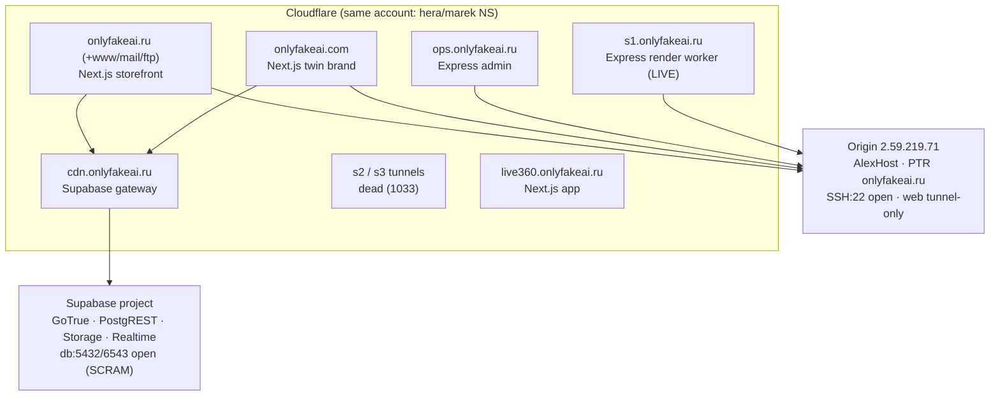

# Domains & infrastructure — the complete estate

Every domain and subdomain associated with the target, recovered by certificate transparency,
DNS brute force (5,063 names), passive DNS, RDAP and threat-intel. Certificate and DNS evidence lives in
[`../evidence/artifacts/`](../evidence/artifacts/).

> **Full evidence-tiered inventory** (47 entries: domains, endpoints, contacts, threat-intel records, plus
> unverified brand space and a registrar-adjacent lead): [`domain-inventory.md`](domain-inventory.md) ·
> machine-readable: [`../data/domain-inventory.csv`](../data/domain-inventory.csv).

---

## 1. Operator-owned — primary brand

### `onlyfakeai.ru` — the live service

| Host | Role | Status at assessment | Evidence |
|---|---|---|---|
| `onlyfakeai.ru` | Apex: Next.js document-forgery storefront (14 locales, 232 SKUs) | **live** (Cloudflare) | `site-home.headers` |
| `www.onlyfakeai.ru` | Same Next.js app | live | `subdomain-brute-summary.json` |
| `mail.onlyfakeai.ru` | Same web app routed through mail hostname (no MX stack found) | live | `subdomain-brute-summary.json` |
| `ftp.onlyfakeai.ru` | Same web app on ftp hostname | live | `subdomain-brute-summary.json` |
| `cdn.onlyfakeai.ru` | **Supabase gateway**: GoTrue v2.197.0, PostgREST, Storage, Realtime | live | `docs/architecture.md` |
| `ops.onlyfakeai.ru` | **Express admin dashboard** — profiles, jobs, credits, API keys, analytics | live, unauthenticated login page / full API map exposed | `ops-admin-panel.html`, `ops-admin-bundle.js` |
| `s1.onlyfakeai.ru` | **Express render worker** — generation jobs | **live**; `/health` leaks loopback + echoes headers | `worker-s1-probe.json` |
| `s2.onlyfakeai.ru` | Worker/minio tunnel | dead tunnel (Cloudflare Error 1033) | `worker-tunnel-watch.log` |
| `s3.onlyfakeai.ru` | Likely MinIO/S3 backend (backups, configs) | dead tunnel (1033) — watcher kept on it | `worker-tunnel-watch.log` |
| `live360.onlyfakeai.ru` | Separate Next.js "live360" application | live | `live360-probe.json` |

All resolve to the same Cloudflare edge IPs (`104.21.19.222`, `172.67.190.106`) via nameservers
`hera.ns.cloudflare.com` / `marek.ns.cloudflare.com`.

**Certificates:** wildcard `*.onlyfakeai.ru` (Let's Encrypt), plus separate certs for `ops`, `cdn`, `s1`–`s3`.
Recovered from `crt.sh` — this is how the unlinked admin plane and worker tier were found.

### `onlyfakeai.com` — the operator's second domain (same Cloudflare account)

| Fact | Detail |
|---|---|
| Apex | **live** Next.js site: "OnlyFake - AI Document Generator | Professional Templates" |
| Nameservers | **`hera.ns.cloudflare.com` + `marek.ns.cloudflare.com` — identical to `onlyfakeai.ru`** |
| Verdict | **same operator, same Cloudflare account** — the `.com` brand twin |
| Certificates | `*.onlyfakeai.com` wildcard (Google Trust Services WE1 + Let's Encrypt) |
| Subdomains | `www`, `ops`, `cdn`, `s1`, `s2`, `s3`, `mail` do **not** resolve on `.com` (checked) |

Evidence: `brand-variants.json`, `brand-sites.json`, `certspotter-com.json`, `crtsh-com.json`, `siblings.jsonl`.

## 2. Origin host — "hosted locally", exposed anyway

| Fact | Detail |
|---|---|
| Origin IP | **`2.59.219.71`** |
| PTR | `onlyfakeai.ru.` — reverse DNS names the target directly |
| Provider | AlexHost SRL (AS200019) |
| Open ports | **22 (SSH) open**, Ubuntu + OpenSSH 8.9p1; 80/443 unreachable (web ingress = Cloudflare Tunnel only) |
| Interpretation | The operator runs the platform on their own box behind a Cloudflare Tunnel. No managed-cloud safety, no origin hiding. |

Evidence: `origin-probe.json`, `intel-checkhost-status.json`.

## 3. Database surface

| Endpoint | Status |
|---|---|
| `db.<project-ref>.supabase.co:5432` | open — SCRAM-SHA-256 handshake |
| `db.<project-ref>.supabase.co:6543` | open — pooler "no such user" for guessed user |
| `aws-0-eu-central-2.pooler.supabase.com:5432/6543` | open — SCRAM |
| `aws-1-eu-central-2…`, `aws-0-us-east-1…` | reachable, tenant not found for this project |

Evidence: `supabase-db-probe.json` (project ref redacted in this repository).

## 4. Mail posture

- `_dmarc.onlyfakeai.ru` — **NXDOMAIN** (no DMARC).
- `_mta-sts.onlyfakeai.ru`, `mta-sts.onlyfakeai.ru` — NXDOMAIN.
- Mail hostnames route to the same Cloudflare web edge; no dedicated mail service fingerprint was obtained.
- Consequence used in the assessment: without SPF/DKIM/DMARC, spoofed system mail from the domain is
  deliverable (documented, not exploited).

Evidence: `email-posture.jsonl`.

## 4b. Operator contacts & registration (public record)

| Identifier | What it is | Source |
|---|---|---|
| `t.me/onlyfakeadmin` | Admin/support Telegram published by the site | PhishDestroy observed indicators |
| `t.me/onlyfakeai_bot` | Bot account published by the site | PhishDestroy observed indicators |
| `onlyfake@tuta.io` | Owner contact / registered admin identity | site + signup oracle |
| `admin@onlyfakeai.ru` · `support@onlyfakeai.ru` · `onlyfake@onlyfakeai.ru` | Registered identities | signup oracle |
| Registrar **REGRU-RU**, created **2026-03-03**, expires **2027-03-03** | Domain registration — purpose-built 4 months before first detection | threat-intel registration record |
| `teleperformancerabota.ru` | **Lead only** — same registrar as target, 14 VT detections; **no** shared NS/IP/cert | PhishDestroy related-reports |

## 5. Brand / typo-squat family (NOT verified as operator-owned)

These are names in the same brand space, recovered from DNS/RDAP. Different nameservers in every case —
listed for completeness, **not** claimed as the operator's:

`onlyfake.ai` (live; distinct Cloudflare account) · `onlyfake.com` (AWS nameservers) ·
`onlyfake.org` · `onlyfake.net` · `onlyfake.io` · `onlyfake.ru` · `onlyfake.shop` · `onlyfake.store` ·
`onlyfake.cc` · `onlyfakeai.net` · `onlyfakeai.org` · `onlyfakeai.io` · `onlyfakeai.app` ·
`onlyfakeai.co` · `onlyfakeai.site` · `onlyfakeai.xyz` · `onlyfakeai.top` · `onlyfakeai.store` ·
`onlyfakedocs.com` · `fakeai.ru`

Evidence: `brand-variants.json`, `brand-sites.json`, `siblings.jsonl`.

## 6. Third-party verdict

**PhishDestroy:** domain `onlyfakeai.ru` — **Critical**, evidence score **88**, in destroy list,
first detected **2026-07-18**. Risk signals: "Stored PhishDestroy threat listing", "Last known active".
VirusTotal at export: 0/92 (detection lag typical for fresh criminal infrastructure).

Evidence: `phishdestroy-verdict.json`.

---

## Map

---

*Sanitisation note: the Supabase project reference, publishable key and our own egress IP are redacted in
this repository. Public DNS facts (domains, origin IP, PTR) are retained as evidence.*
